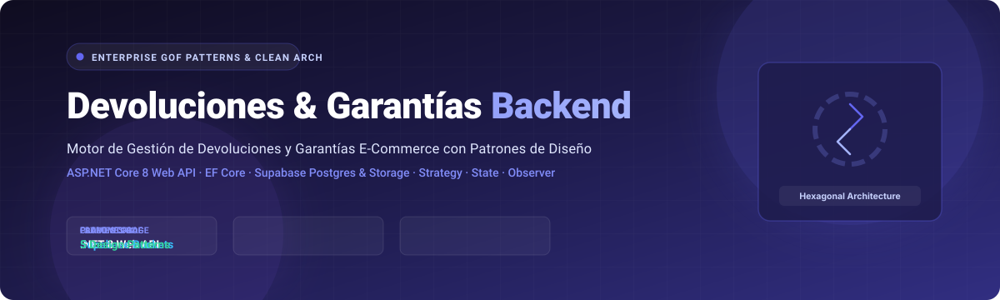
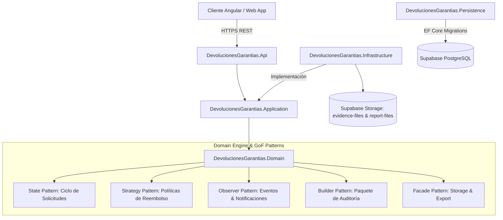

<p align="center">
  
</p>

<p align="center">
  
  
  
  
  
  
</p>

<p align="center">
  
</p>

## 📦 Visión General del Sistema

**DevolucionesGarantias Backend** es un motor empresarial desarrollado con **.NET 8 Web API** bajo los principios de **Clean Architecture** (Arquitectura Hexagonal / Cebolla) para la gestión integral del servicio post-venta en plataformas de comercio electrónico.

El sistema administra el ciclo de vida de devoluciones monetarias, cambios físicos por insatisfacción y garantías técnicas por defecto de fábrica, integrando almacenamiento de evidencias fotográficas en **Supabase Storage**, persistencia transaccional en **PostgreSQL**, y la implementación práctica de patrones de diseño clásicos del Gang of Four (GoF) para garantizar mantenibilidad y extensibilidad extrema.

---

## 🏛️ Arquitectura por Capas y Patrones de Diseño



---

## 🧩 Implementación de Patrones de Diseño (GoF)

La capa de dominio modela comportamientos complejos mediante patrones formales:

| Patrón GoF | Tipo | Aplicación en el Negocio |
| :--- | :---: | :--- |
| **State** | Comportamiento | Modela las transiciones válidas de una reclamación: `Registrada` → `EnRevisiónTécnica` → `Aprobada`/`Rechazada` → `ReembolsoEmitido`. Previene estados imposibles. |
| **Strategy** | Comportamiento | Algoritmos intercambiables para liquidar el monto a reembolsar según la política aplicable (devolución al 100%, depreciación por uso, saldo a favor en tienda). |
| **Observer** | Comportamiento | Desacopla la lógica de negocio del envío de notificaciones: cuando un reclamo cambia de estado, los suscriptores suscritos (email, auditoría) reaccionan asíncronamente. |
| **Builder** | Creacional | Construcción fluida de reportes técnicos complejos y actas de devolución multi-ítem con validación en cada paso. |
| **Facade** | Estructural | Unifica el cliente de almacenamiento en la nube de Supabase y el generador de reportes en una interfaz simplificada para la capa de aplicación. |

> 📐 **Diagrama de Clases UML:** Disponible en [`docs/uml/diagrama_clases_unificado_organizado.puml`](docs/uml/diagrama_clases_unificado_organizado.puml) y especificación completa en [`docs/arquitectura-tecnica-devoluciones-garantias.md`](docs/arquitectura-tecnica-devoluciones-garantias.md).

---

## 🚀 Configuración y Puesta en Marcha Local

### Prerrequisitos
- **.NET SDK:** Versión 8.x
- **PostgreSQL / Supabase:** Instancia activa con extensiones relacionales
- **Supabase Storage:** Buckets `evidence-files` y `report-files`

### 1. Variables de Entorno y Configuración
Configura tus credenciales locales mediante variables de entorno o **.NET User Secrets**:

```powershell
$env:ConnectionStrings__NeonPostgres="Host=<HOST>;Port=5432;Database=<DATABASE>;Username=<USER>;Password=<PASSWORD>;SSL Mode=Require;Trust Server Certificate=true"
$env:Jwt__Issuer="DevolucionesGarantias"
$env:Jwt__Audience="DevolucionesGarantias.Angular"
$env:Jwt__Secret="<TU_SECRETO_JWT_MINIMO_32_CARACTERES>"
$env:Jwt__AccessTokenExpirationMinutes="60"
$env:Supabase__Url="https://<TU_PROYECTO>.supabase.co"
$env:Supabase__ServiceRoleKey="<TU_SERVICE_ROLE_KEY>"
$env:Supabase__EvidenceBucket="evidence-files"
$env:Supabase__ReportsBucket="report-files"
```

### 2. Restaurar y Compilar
```powershell
dotnet restore
dotnet build
```

### 3. Ejecutar Migraciones de Base de Datos
```powershell
dotnet ef database update --project src/DevolucionesGarantias.Persistence --startup-project src/DevolucionesGarantias.Api
```

### 4. Iniciar el API
```powershell
$env:ASPNETCORE_ENVIRONMENT="Development"
dotnet run --project src/DevolucionesGarantias.Api
```
- **Documentación Swagger / OpenAPI:** `http://localhost:5000/swagger`

---

## 🧪 Pruebas Unitarias y de Integración

```powershell
# Ejecutar todas las pruebas con reporte en consola
dotnet test DevolucionesGarantias.sln --logger "console;verbosity=normal"
```

---

## 📁 Estructura del Repositorio

```text
Sistema-de-Devoluciones-BackEnd/
├── docs/
│   ├── images/
│   │   ├── banner.svg           # Hero banner vectorial
│   │   └── divider.svg          # Separador decorativo
│   ├── uml/                     # Diagramas UML de clases en PlantUML
│   └── arquitectura-tecnica...  # Especificación de arquitectura
├── src/
│   ├── DevolucionesGarantias.Api/           # Endpoints, Swagger y Middleware
│   ├── DevolucionesGarantias.Application/   # Casos de uso, DTOs y validaciones
│   ├── DevolucionesGarantias.Domain/        # Entidades y patrones GoF
│   ├── DevolucionesGarantias.Infrastructure/# Supabase Storage, JWT y notificaciones
│   ├── DevolucionesGarantias.Persistence/   # EF Core, contextos y migraciones
│   └── DevolucionesGarantias.Shared/        # Respuestas comunes y utilidades
├── tests/
│   ├── DevolucionesGarantias.UnitTests/     # Pruebas unitarias de dominio
│   └── DevolucionesGarantias.Integration... # Pruebas de integración
├── DevolucionesGarantias.sln
└── README.md
```

---

## 👨‍💻 Autor y Licencia

Desarrollado por **Santiago Ospina Arango**  
- **GitHub:** [@santi-osp](https://github.com/santi-osp)  
- **Licencia:** [MIT License](LICENSE)

---

<p align="center">
  <sub>Devoluciones & Garantías Backend · Arquitectura Limpia y Patrones de Software en .NET 8.</sub>
</p>